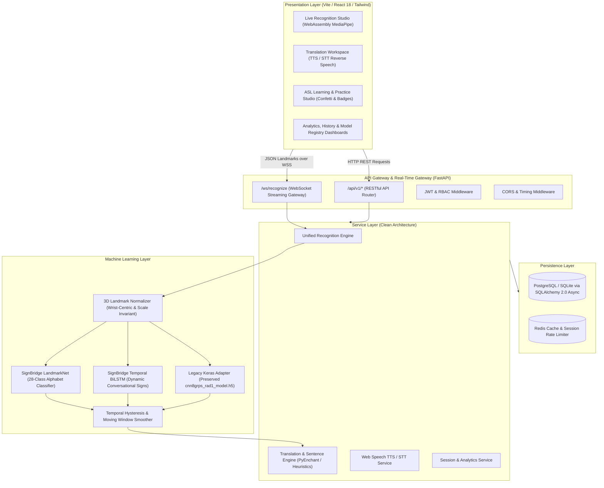
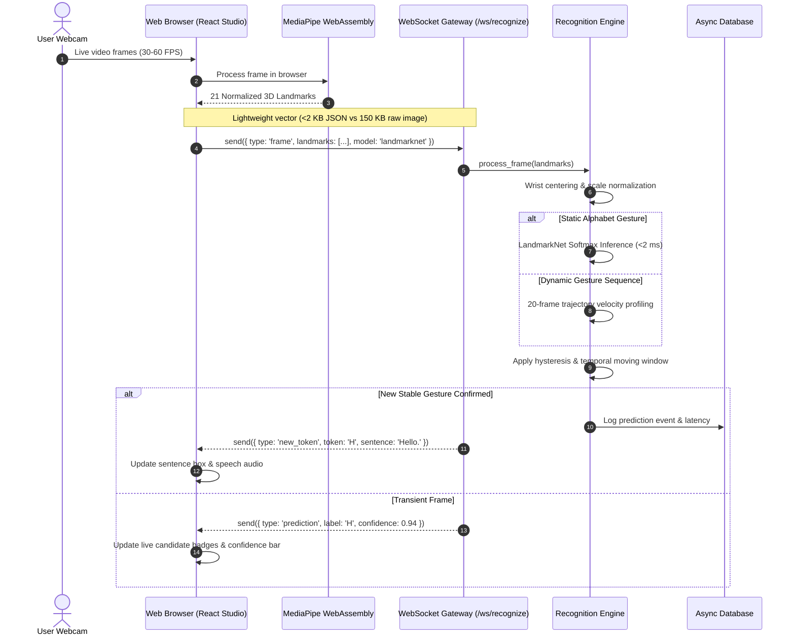

# SignBridge AI — System Architecture & Topology

## 1. High-Level Architecture Overview

SignBridge AI is designed using a **Clean Architecture / Modular Monolith** pattern that decouples the presentation layer, real-time gateway, business domain services, machine learning inference engines, and persistent storage.

---

## 2. Real-Time WebSocket Communication Flow

---

## 3. Technology Stack Breakdown

| Tier | Technology | Purpose |
| :--- | :--- | :--- |
| **Frontend** | React 18, TailwindCSS, Vite, Lucide Icons | Responsive SaaS UI with dark/light mode and 10 dedicated routes |
| **Hand Tracking** | MediaPipe Hands WebAssembly | In-browser client-side 3D landmark extraction (preserves user camera privacy) |
| **Backend API** | FastAPI, Uvicorn, Python 3.10 | Async REST endpoints, OpenAPI docs, and real-time WebSockets |
| **Inference Engines** | PyTorch, Keras 2.11, NumPy, Scikit-learn | Multi-model architecture: LandmarkNet, BiLSTM, and Legacy Keras adapter |
| **Database** | PostgreSQL 16 / aiosqlite, SQLAlchemy 2.0 | Async ORM, migration-ready schema with 8 relational tables |
| **Audio & Speech** | Web Speech API & Pyttsx3 | Real-time text-to-speech output and reverse speech-to-text dictation |
| **DevOps** | Docker, Docker Compose, GitHub Actions | Multi-container production deployment and automated CI testing |
