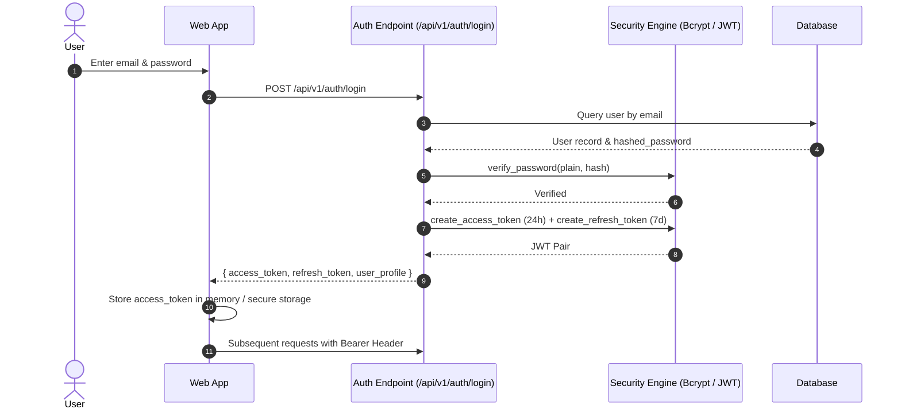
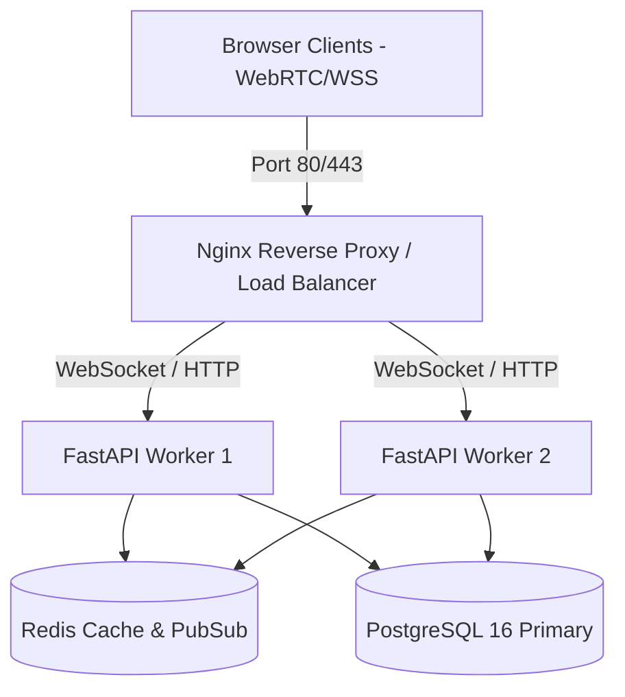

# SignBridge AI — System Design Document

## 1. Executive Summary

SignBridge AI is an enterprise-grade AI application transforming isolated American Sign Language (ASL) recognition into a unified, continuous translation and accessibility platform. The system bridges the communication gap between Deaf/Hard-of-Hearing individuals and hearing individuals via real-time computer vision, kinematic normalization, sequence modeling, and bi-directional speech-to-text / text-to-speech.

---

## 2. Architectural Boundaries & Principles

1. **Separation of Concerns**:
   - The computer vision feature extraction occurs in the client's browser, preventing heavy video bandwidth transmission over the network and guaranteeing user privacy.
   - The backend handles high-speed matrix inference, temporal stabilization, grammatical structuring, session telemetry, and user management.
2. **Preservation of Legacy Assets**:
   - The original Keras model `cnn8grps_rad1_model.h5` is encapsulated in `LegacyKerasAdapter`, allowing users and researchers to compare legacy CNN heuristics against modern kinematic landmark models side-by-side.
3. **Graceful Degradation**:
   - If WebSockets drop, the client falls back to REST `/api/v1/recognition/recognize`.
   - If PostgreSQL is absent locally, SQLAlchemy automatically defaults to asynchronous SQLite (`signbridge.db`).
   - If pyenchant dictionary libraries are missing on a host, an internal 1000-word high-frequency English dictionary provides continuous autocorrect and suggestions.

---

## 3. Authentication & Authorization Flow

---

## 4. Scalability & Deployment Architecture

